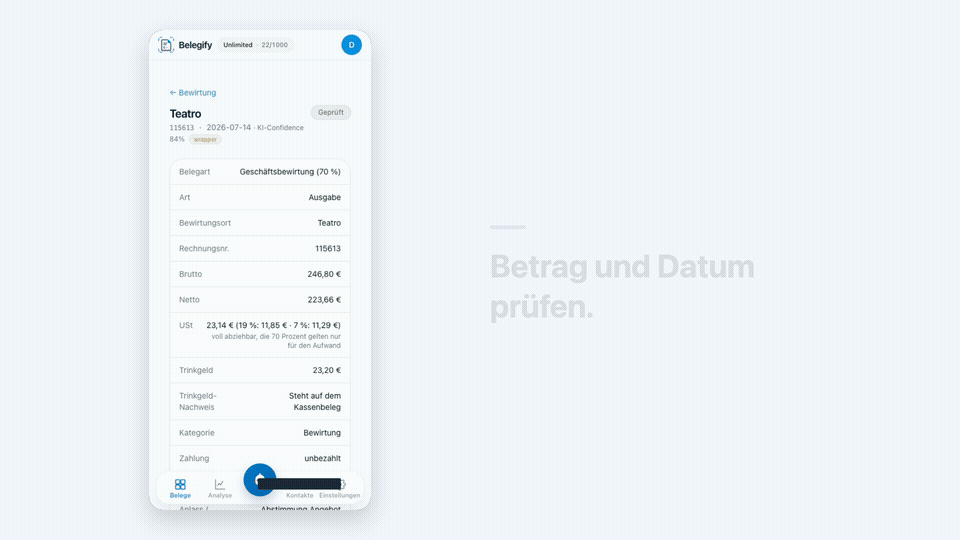
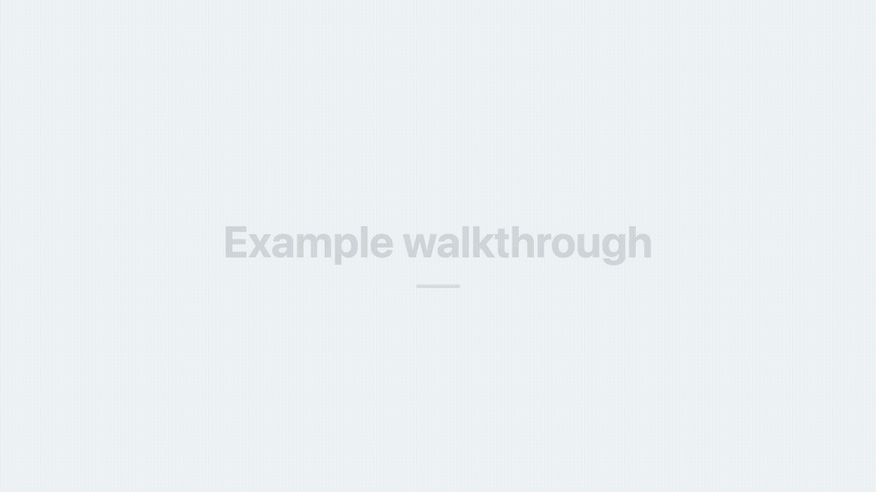

# See the input and the result

## A real product recording: Belegify

[](belegify-long.mp4)

- [Landscape walkthrough](belegify-long.mp4): 1920 × 1080, 688 frames, 22,933 seconds.
- [Portrait short](belegify-short.mp4): 1080 × 1920, 453 frames, 15,100 seconds.

This is the actual Belegify application, recorded while navigating an existing demonstration receipt. The receipt was already marked as checked. The clip compares the photo with existing fields and shows the edit entry point; it does not create, correct, approve or send a receipt. Configured demo fields are covered in the recording.

Copy and the edit specification were prepared by Codex. A coding agent connected through the running Conduit Bridge started the local renderer; a separate Conduit request read the completed verification report. These are caption-only videos without a voice track. The private account session, app recording plan and full Belegify source recording are not included.

## Reproduce a neutral example

[](neutral-long.mp4)

| Input | Outputs |
| --- | --- |
| [Source recording](neutral-source.mp4), 780 × 1688 | [Landscape](neutral-long.mp4), 1920 × 1080, 13,300 seconds |
| [Edit specification](spec.json) | [Portrait](neutral-short.mp4), 1080 × 1920, 8,900 seconds |

This recording shows the local pages in `examples/neutral`. It is a technical fixture, not a product or a customer account. After setup, run from the repository root:

```sh
mkdir ../my-first-conduit-input && cp docs/demo/neutral-source.mp4 ../my-first-conduit-input/
npm run render -- --spec docs/demo/spec.json --media-dir ../my-first-conduit-input --out ../my-first-conduit-video
```

To make a new recording of those pages as well as rendering it:

```sh
npm run example -- --out ../my-recorded-conduit-example
```

Both commands produce the videos, SRT/VTT captions, scene stills, posters, contact sheets and a verification report. [Follow the complete first-run guide](../../QUICKSTART.md).

The checked-in videos are the measured pilot outputs. Their sizes, frame counts and SHA-256 hashes are recorded in [media-manifest.json](media-manifest.json). A newly captured run can have different scrolling timing.

## Reuse

The neutral fixture, its source recording and neutral outputs are covered by this repository's MIT license. The Belegify videos and preview/poster demonstrate the workflow; they are copyright Comms Connect GmbH and may be shared unchanged with attribution to Belegify and a link to https://belegify.app. They do not grant rights to reuse the Belegify brand for another product. Dependencies, including Remotion, keep their own licenses.
